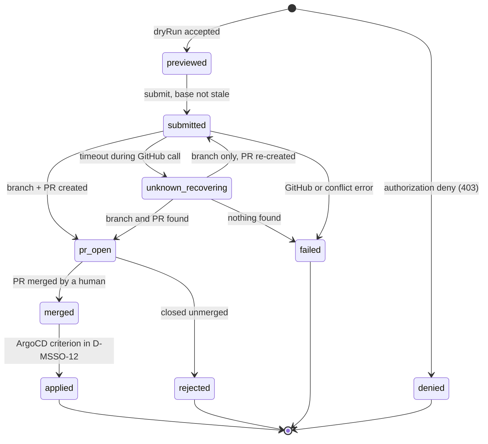

# ADR-0009: Git PR 기반 SSO 변경 요청 — 선언적 SSO 구성의 제어된 편집

- **상태**: 제안됨(Proposed) — 설계 제안이며, 본 ADR로 구현되는 쓰기 엔드포인트, GitHub 연동, 인가 코드, 감사 저장소, `allowedGroups`의 게이트웨이 소비자는 없습니다.
- **날짜**: 2026-10-17
- **이슈**: 기록된 이슈 없음(*미검증*).
- **관련**: [ADR-0002](0002-backend-api-technology-ko.md)(Domain API, Hono; D-MSSO-7은 이 ADR의 OPA 결정에 대한 명시적 예외), [ADR-0006](0006-safe-actions-ko.md)(Safe Actions, 0절 필수 선행 조건), [ADR-0008](0008-gitops-argocd-integration-ko.md)(읽기 전용 ArgoCD 계정), beluga 루트 `docs/adr/0006-gateway-sso-oidc-architecture.md`(Gateway SSO/OIDC, 레포 루트)(D-SSO-1..4; manager의 ADR-0006과 다른 계열), `AGENTS.md`(도메인 레지스트리, 독립 리뷰 게이트).
- **의사결정자**: dasomel

표기 규칙: **현재 상태**는 관측한 사실만 적습니다(파일/심볼 또는 실행한 명령, 근거 일자 2026-10-17, beluga `main` `76500d5`). 그 외는 설계 의도입니다. 수치는 *제안값*입니다. 외부 사실은 공식 URL을 인용하거나 *미검증*으로 표기합니다.

결정 ID: Stage 2 코드(PR #283에서 병합)가 이미 D-MSSO-1..5를 사용합니다(`config.ts`, `adapters/sso/ssoAdapter.ts`, `routes/sso.ts`, `schema/sso.ts`, `web/src/views/SsoView.tsx`). 본 ADR은 **D-MSSO-6**부터 이어가며 D-MSSO-14는 이번 개정에서 신설했습니다. `GET /api/v1/sso`는 PR #283부터 `main`에 있습니다.

## 배경

`gitops/values/sso.yaml`은 단일 선언적 SSO 원천(beluga D-SSO-1)이며 두 ArgoCD Application이 소비하고(`valueFiles: ../../values/sso.yaml`) 둘 다 `selfHeal: true`입니다. 현재 SSO를 바꾸는 방법은 이 파일을 손으로 고치는 것뿐입니다. 소유자는 Manager가 편집을 제공하되 **Git 풀 리퀘스트로 영속화**하기로 결정했습니다(`main` 직접 커밋 아님, 클러스터 ConfigMap 아님). 병합은 사람이, 반영은 ArgoCD가 합니다.

**소유자 결정(2026-10-17)**: Manager에서 편집 가능한 SSO 설정은 **"접근 허용 그룹"** 하나입니다. 게이트웨이 보호 엔드포인트(mode `gateway-oidc`)별 신규 필드 `allowedGroups`(Keycloak 그룹명 배열)를 둡니다. 첫 반복은 **`flink`와 `filer`만** 엽니다(D-MSSO-8). 편집은 **APISIX가 이 필드를 실제로 소비하게 된 뒤에만** 엽니다(롤아웃 ②a). 설계 비평(REVISE)에서 이전 편집 필드인 `app-oidc` 엔드포인트의 `protectedPathPrefixes`는 어떤 차트 템플릿도 읽지 않아, 편집해도 파일만 바뀌고 동작은 바뀌지 않는다는 점이 드러나 그 계약을 삭제했습니다.

### 현재 상태(관측)

| 사실 | 근거 |
|---|---|
| Domain API에는 인증이 없고, `createApp`은 `/api/*`에 origin `http://localhost:5180` CORS만 등록한다. | `manager/packages/domain-api/src/app.ts`(`createApp`, `cors(...)`). |
| Stage 2(읽기 전용 `GET /api/v1/sso`)는 병합됐다(PR #283). 쓰기 라우트는 없고 어댑터는 로컬 파일을 읽는다. | `manager/packages/domain-api/src/routes/sso.ts`, `adapters/sso/ssoAdapter.ts`; 코드 주석 D-MSSO-2 "Mutations (Stage 3) will be handled via GitOps pull requests". |
| `gitops/` 아래에 Manager Deployment, Application, 라우트가 없다. | `git grep -il "domain-api\|beluga-manager" -- gitops` 결과 없음. |
| `sso.yaml`에는 아직 `allowedGroups`가 없다. 엔드포인트: `flink`, `filer`, `catalog-ui`(`gateway-oidc`); `argocd`, `trino`, `superset`, `airflow`, `openmetadata`(`app-oidc`); `catalog-api`, `s3`(`none`). | `gitops/values/sso.yaml`. |
| `protectedPathPrefixes`를 소비하는 것은 `gateway-oidc` 라우트 셋뿐이며 `app-oidc`를 읽는 템플릿은 없다. | `git grep -n protectedPathPrefixes -- gitops/charts scripts`는 `gitops/charts/beluga-data/templates/10-apisix-route.yaml`(14-16, 184, 281, 345행)만 반환. |
| 각 `gateway-oidc` 라우트는 `openid-connect`(`scope: "openid profile email"`, `set_userinfo_header: false`)와 `X-Userinfo`·`X-Access-Token`·`X-ID-Token`을 지우는 `proxy-rewrite`를 쓴다. 그룹 검사는 없다. APISIX는 3.17.0. | `10-apisix-route.yaml`(lakekeeper-ui, filer, flink 블록); `VERSIONS.md`(APISIX 행). |
| `apisix-gateway` Keycloak 클라이언트의 `defaultClientScopes`에 `groups` 스코프가 이미 있다. | `gitops/charts/beluga-platform/templates/keycloak-clients.yaml:273`. |
| realm 그룹은 `analysts`, `engineers`, `admins`(정책 원천)이며 Keycloak에서는 LDAP 기반이다. 테스트 사용자: `beluga-admin`(admins), `beluga-engineer`(engineers), `beluga-analyst`(analysts). | `policies/groups.yaml`; `templates/keycloak-group-mapper.yaml`; `templates/keycloak-users.yaml`(`USERS`). |
| `scripts/ci/check-gateway-sso.py`는 차트를 렌더해 모든 `gateway-oidc` 엔드포인트에 헤더 정리된 `openid-connect` 라우트가 있는지 감사하고, `tests/20-gateway-sso.sh`는 엔드포인트별 로그인 흐름의 라이브 검증이다. | `scripts/ci/check-gateway-sso.py`(docstring, `audit_gateway_routes`); `tests/20-gateway-sso.sh`. |
| OPA는 네임스페이스 `iam`의 Deployment `opa`(`replicas: 1`)이고 정책은 ConfigMap `opa-policies`(`trino.rego`, `kafka.rego`)에서 오며, 어떤 변경이든 `checksum/policies` 어노테이션이 Pod를 롤링한다. **Manager용 정책 패키지는 없다.** | `gitops/charts/beluga-platform/templates/opa.yaml`(`replicas` 30행, `checksum/policies` 41행). |
| CNPG 오퍼레이터 1.30.0은 부트스트랩 스크립트가 클러스터 전역에 설치한다(매니페스트 적용, `cnpg-system`의 `cnpg-controller-manager` 롤아웃 대기). 기존 클러스터 `postgres-main`(네임스페이스 `database`, `instances: 1`, `storage.size: 5Gi`)은 `beluga-data` 소속이다. | `scripts/gitops/01-argocd-bootstrap.sh:482,515`; `VERSIONS.md`(CNPG 행); `gitops/charts/beluga-data/templates/02-cnpg.yaml`. |
| Keycloak 26.7.1. realm import는 최초 기동 1회뿐이라 기존 클러스터의 클라이언트는 Sync 훅 Job `keycloak-clients`(네임스페이스 `iam`)가 교정한다. | `VERSIONS.md`; `templates/keycloak-clients.yaml` 머리 주석; beluga D-SSO-3. |
| `beluga-platform`은 `platform-system`/`iam`에 배포하고 `beluga-data`는 별도 Application이며 둘 다 `selfHeal: true`다. | `gitops/apps/beluga-platform.yaml`, `templates/00-namespaces.yaml`. |
| 머지에는 PR head SHA의 `independent-review` 상태가 필요하며, 이를 required로 지정할지는 소유자 몫이다. | `AGENTS.md`(독립 리뷰 게이트). |

### 외부 참고 자료(2026-10-17 열람)

- GitHub App 설치 토큰 — <https://docs.github.com/en/apps/creating-github-apps/authenticating-with-a-github-app/generating-an-installation-access-token-for-a-github-app>: "The installation access token will expire after 1 hour."
- GitHub App JWT — <https://docs.github.com/en/apps/creating-github-apps/authenticating-with-a-github-app/generating-a-json-web-token-jwt-for-a-github-app>: 만료는 "must be no more than 10 minutes into the future".
- OPA REST API(D-MSSO-7 후속용) — <https://www.openpolicyagent.org/docs/rest-api>: 정의되지 않은 문서는 HTTP 200에 **`result` 키 없이** 응답한다.
- GitHub contents API — <https://docs.github.com/en/rest/repos/contents>: 파일 갱신에는 `sha`("the blob SHA of the file being replaced")가 필요하다. 오래된 `sha`가 어떤 상태 코드를 반환하는지는 문서에 없다(409와 422가 모두 나열됨): *미검증*이므로 쓰기 호출의 409/422를 모두 충돌로 취급한다.
- 열람하지 않음, *미검증*, 구현 시 확인: Keycloak PKCE/클라이언트 설정, 26.7.1의 realm JWT 알고리즘과 JWKS 경로; `groups` 클레임 이름과 그룹 값이 `admins`인지 `/admins`인지; GitHub git-refs/compare 엔드포인트; GitHub ruleset(`refs/heads/sso/*` 대상 지정과 bypass 목록); CNPG 선언적 롤과 생성 Secret(<https://cloudnative-pg.io/documentation/1.30/> 해당 페이지 미열람); CNPG 오퍼레이터가 `platform-system`을 감시하는지.
- D-MSSO-14가 쓰는 APISIX 3.17.0 플러그인 동작(`openid-connect`가 사용자 정보를 `ctx.external_user` 또는 `X-Userinfo` 헤더에 저장, `claim_schema`, `required_scopes`, `authz-keycloak`, access 단계의 `serverless-post-function`)은 조정자의 조사에서 온 것으로 여기서는 *미검증*이며, **구현 전에 3.17.0 소스로 재확인**한다.

## 결정 동인

1. ADR-0006 0절을 그대로 적용한다: 토큰 검증 전에는 변경 라우트 금지, 액션별 인가, bearer 전용 자격증명, confused-deputy 대응, 멱등성, 감사.
2. SSO 상태는 Git으로만 바뀐다. Manager는 병합·클러스터 수정·동기화를 하지 않는다.
3. 무엇을 편집할 수 있는지는 UI가 아니라 서버가 강제한다. SSO 구성은 보안 경계다.
4. 실패 시 닫힘: 신원, 정책, 감사 중 하나라도 의심되면 쓰기를 거부한다.
5. 필드는 실행 중인 컴포넌트가 소비하고 테스트가 효과를 증명할 때만 편집 가능하다.

## 검토한 대안

1. **Manager가 `main`에 직접 커밋** — 기각: 리뷰와 독립 리뷰 게이트를 건너뛴다.
2. **Manager가 클러스터의 ConfigMap/Application을 패치** — 기각: `selfHeal`이 조용히 되돌리고(`docs/mistakes-log.md`, 2026-08-25 항목) Git을 우회한다.
3. **Git 쓰기에 개인 액세스 토큰(PAT)** — 기각: 자격증명이 개인 계정에 귀속되고 장기 토큰이다(fine-grained PAT는 단일 레포로 범위를 좁힐 수 있음을 인정한다). GitHub App은 설치 단위 신원이며 토큰이 1시간짜리다.
4. **bearer JWT 대신 게이트웨이 세션 인증(APISIX)과 전달된 신원 헤더** — 쓰기 경로에는 기각: Domain API가 헤더를 검증할 수 없다. beluga D-SSO-2가 헤더를 정리하는 이유가 위조 가능성이다.
5. **공유 `postgres-main`에 감사 테이블(이전 개정)** — 기각: Manager(`beluga-platform`)가 다른 Application 네임스페이스의 Secret과 `pg_hba` 로그인을 필요로 하고, 롤 SQL이 `policyctl` 생성 블록 옆 `db-roles.sql`에 들어가며, ArgoCD는 Application 간 순서를 보장하지 않는다. 전용 클러스터로 대체(D-MSSO-11).
6. **첫 반복부터 OPA 정책으로 인가** — 보류: `opa-policies`를 바꾸면 단일 OPA 레플리카가 롤링되어(`replicas: 1`, `checksum/policies`) Trino·Kafka 인가가 끊길 수 있다. `replicas >= 2`가 선행되어야 한다(D-MSSO-7 탈출구).
7. **`app-oidc` 엔드포인트의 `protectedPathPrefixes` 편집 개방(이전 개정)** — 기각: 소비하는 템플릿이 없다(현재 상태).
8. **APISIX 내장 기능으로 그룹 검사** — `openid-connect`의 `claim_schema`: 기각(실패 시 403이 아닌 401이고 배열 "contains" 검사를 지원하지 않음, *미검증*). `required_scopes`: 기각(스코프는 그룹이 아니며 세션/리다이렉트 흐름에 맞지 않음). `authz-keycloak`: 기각(토큰/UMA 리소스 인가용으로 브라우저 세션 흐름에 부적합). 채택: D-MSSO-14.
9. **SPA PKCE + bearer JWT, 프로세스 내 인가, GitHub App PR, 전용 CNPG 감사(채택)** — D-MSSO-6..14.

## 결정

### D-MSSO-6 인증 — 공개 PKCE 클라이언트, bearer JWT(RS256)

- Keycloak realm `beluga`에 새 **공개** 클라이언트 `beluga-manager`(Authorization Code + PKCE, redirect URI `https://manager.<baseDomain>/*`)를 둔다. D-SSO-3이 `apisix-gateway`에 한 것처럼 `keycloak-clients` Job을 확장해 멱등하게 만든다. PKCE와 클라이언트 설정 이름은 26.7.1 기준 *미검증*.
- Domain API는 모든 `/api/v1/sso/change-requests*` 라우트에서 `Authorization: Bearer`를 검증한다: realm JWKS 서명(캐시, 내부 CA 신뢰), **알고리즘을 `RS256`으로 고정**(`none`, `HS*` 포함 그 외는 거부; realm이 RS256으로 서명하는지는 *미검증*), `iss`가 정확히 `https://sso.local.beluga.internal/realms/beluga`(`sso.yaml`에서), `aud`에 `beluga-manager` 포함, `exp`/`nbf`에 작은 허용 오차(*제안값*: 30초). 쿠키는 자격증명으로 받지 않으므로 CSRF는 해당 없다(ADR-0006 0절 3항).
- 인증이 구성되지 않으면 라우트는 열리지 않고 503으로 응답한다.

### D-MSSO-7 인가 — 프로세스 내, 기본 거부(ADR-0002 예외)

- **첫 반복**: Domain API가 쓰기를 직접 인가한다. 쓰기(`preview`, `submit`)는 **검증된** JWT의 `groups` 클레임에 `admins`가 있을 때만 허용하고 그 외는 모두 **403**이다. 그룹 목록은 검증된 토큰에서만 읽으며 요청 본문이나 헤더는 쓰지 않는다. 단위 테스트: 허용, `groups` 없음, 잘못된 타입, 빈 목록, 그룹명 변형(`admins` vs `/admins`, 실제 토큰 기준), 변조·만료 토큰. 인가는 미리보기뿐 아니라 제출 시에도 다시 평가한다.
- **예외 기록**: ADR-0002 결정 3은 세부 인가를 OPA에 위임한다. 본 ADR은 첫 반복에 한해 의도적으로 벗어난다. Rego 패키지를 추가하면 단일 OPA 레플리카가 롤링되기 때문이다(검토한 대안 6).
- **탈출구(후속, 일정 없음)**: OPA가 `replicas >= 2`로 돌고 `opa.yaml` args/checksum 롤링이 안전해진 뒤 검사를 OPA(`data.beluga.manager.sso.allow_write`, 정의되지 않았거나 불리언이 아닌 결과 = 거부, 도달 불가 = 503)로 옮긴다. 라우트 수준 계약(403/503)은 바뀌지 않는다.

### D-MSSO-8 편집 계약 — 서버 강제, 필드 하나

서버는 클라이언트가 보낸 문서가 아니라 **패치**(엔드포인트 이름과 새 `allowedGroups` 목록)로 변경을 계산한다. 주석과 순서를 보존해 YAML을 편집하고(라이브러리는 구현 시 선정, *미검증*) 결과를 다시 파싱해, 기준 파일과의 **유일한 차이**가 `flink`, `filer` 중 하나의 `allowedGroups`가 아니면 **422**로 거부한다.

| 엔드포인트 | 편집 가능 | 잠금 |
|---|---|---|
| `flink`, `filer`(`gateway-oidc`) | `allowedGroups` | 나머지 전부: `name`, `host`, `mode`, `clientId`, `protectedPathPrefixes`, `bypassPathPrefixes`, `redirectPath`, `logoutPath` |
| `catalog-ui`(`gateway-oidc`) | 첫 반복에서는 없음 | 모든 필드. 같은 호스트의 `catalog-api`는 게이트웨이를 우회(mode `none`, Lakekeeper 자체 토큰과 OpenFGA가 인가)하므로 UI만 막는 것은 보호가 약하다. API 경로도 그룹 인지 통제로 덮을 때만 연다(*향후 조건*). |
| `argocd`, `trino`, `superset`, `airflow`, `openmetadata`(`app-oidc`) | 없음 | 모든 필드 |
| `catalog-api`, `s3`(`none`) | 없음 | 모든 필드 |

불변식(각각 422와 필드 단위 메시지로 거부):
1. `allowedGroups`는 비어 있지 않고, 문자열만, 중복 없음.
2. 모든 항목이 `policies/groups.yaml`에 존재(`sso.yaml`과 같은 blob-SHA 규율로 `main`에서 읽음).
3. `admins`는 항상 포함(잠금 방지: 편집하는 admins가 접근을 잃지 않게).
4. 어떤 엔드포인트의 다른 필드도, 다른 파일도 바뀌지 않는다. 대상 경로는 서버 상수 `gitops/values/sso.yaml`이며 클라이언트가 고를 수 없다.
5. **미리보기는 의미 비교만 한다**: `allowedGroups` 집합의 전후만 비교하며, 집합이 같으면 **422**("유효 변경 없음")로 응답한다. Manager는 helm을 **실행하지 않는다**. 렌더와 계약 검증은 beluga CI(`check-gateway-sso.py`, D-MSSO-9)에서만 한다.

쓰기 라우트는 명시적 설정 스위치(기본 꺼짐)를 켜기 전까지 503 `CONSUMER_NOT_DEPLOYED`로 응답한다. 스위치는 차트 값에 표지가 있어서가 아니라 롤아웃 ②a의 라이브 테스트가 통과한 뒤에만 켠다.

### D-MSSO-9 동시성, stale 판정, 멱등성

- **stale 규칙(단일 정의)**: 미리보기는 미리보기 시점 `main`의 `gitops/values/sso.yaml` blob SHA인 `baseBlobSha`를 반환한다. 제출 시 서버는 현재 `main` HEAD를 풀어 그 커밋의 해당 파일 blob SHA를 읽고, 다르면 **409 `STALE_BASE`**로 응답한다. 무관한 커밋은 미리보기를 stale로 만들지 않으며 HEAD 동일 여부는 검사하지 않는다.
- 브랜치는 blob을 검사한 **같은 커밋 SHA**에서 만들고, 파일 쓰기에는 그 blob SHA를 `sha`로 넘긴다. 쓰기의 409/422는 충돌이다(단계 `failed`, 호출자에 409).
- **현재 상태 테이블 `sso_change_requests`**(UPDATE 허용, D-MSSO-11의 append-only 감사 테이블과 분리): 요청당 한 행 — `id`, `stage`, `file_path`, `endpoint`, `idempotency_key`, `payload_sha256`, `branch`, `pr_number`, `updated_at`. `(file_path) WHERE stage IN ('submitted','pr_open','unknown_recovering')`의 **부분 유니크 인덱스**가 **파일당 활성 요청 1**을 강제하고, 제출 트랜잭션은 확인 후 삽입 전에 상수 키로 `pg_advisory_xact_lock`을 잡는다. 따라서 동시 제출은 PR 하나만 만들고 진 쪽은 **409 `OPEN_REQUEST_EXISTS`**를 받는다.
- **멱등성**: 헤더 `Idempotency-Key` = 소문자 hex 32자(`sso_change_requests`에서 유일). 브랜치 이름은 결정적이다: `sso/<endpoint>-<키 앞 12자>`, 예: 키 `3f9a1c7e5b2d4a8f9c0e1d2b3a4f5e6d`, `flink`이면 `sso/flink-3f9a1c7e5b2d`. 같은 키와 같은 페이로드의 재시도는 기존 기록을 반환하고, 같은 키에 다른 페이로드 해시는 **422 `IDEMPOTENCY_MISMATCH`**다.
- **머지 시점 재검증(M2)**: `main`은 제출과 머지 사이에 움직일 수 있으므로 Manager의 검사는 참고용이다. 그래서 beluga CI가 `sso.yaml`을 건드리는 모든 PR에서 계약을 다시 강제한다: `check-gateway-sso.py`를 `allowedGroups` 불변식(D-MSSO-8의 1-3)과 helm 렌더 검사로 확장한다. 소유자가 브랜치 보호 "머지 전 최신 상태 필수"를 켜면(소유자 확인 질문 3) 머지는 항상 현재 `main` 기준 CI 뒤에 일어난다.

### D-MSSO-10 Git 쓰기 경로 — GitHub App

- `dasomel/beluga`에만 설치한 GitHub App, 권한 Contents(write), Pull requests(write), Metadata(read). Manager는 JWT(최대 10분)를 만들어 사용 시마다 설치 토큰(1시간)으로 교환하고 메모리에만 캐시한다(위 URL). 코드 경로는 `sso/*` 브랜치와 PR만 만들며 **병합 호출이 없다**.
- **키 취급**: 소유자가 `platform-system`에 Secret(App ID, 설치 ID, 개인 키)을 만들고, Manager ServiceAccount만 그 Secret을 `get`할 수 있는 `Role`을 둔다. 키는 파일로 마운트하며 브라우저, 로그, 감사 행에 나가지 않는다. 이 Secret은 **DR 및 Kakao 재배포 체크리스트에 추가**한다(Secret은 Git에 없다; `csp/kakao-cloud`가 기존 재배포 경로).
- **피해 범위 제한**: GitHub ruleset으로 App의 bypass와 쓰기를 `refs/heads/sso/*`로 제한해 자격증명이 `main`에 푸시할 수 없게 한다(ruleset 기능은 참고 자료대로 *미검증*). 서버는 이와 별개로 경로를 상수 `gitops/values/sso.yaml`로 고정하고 다른 경로는 거부한다.
- PR 본문과 커밋 트레일러에 `Requested-by: <username> (<sub>)`, 사유(길이 제한, 이스케이프된 텍스트로 렌더), diff, `baseBlobSha`를 남긴다. git 작성자는 App이고 사람은 기록으로 남는다. 이것이 **2차** 감사 기록이다.

### D-MSSO-11 감사 — 전용 CNPG 클러스터, 권한으로 append-only, 실패 시 닫힘

- **저장소**: `beluga-platform`의 `platform-system` 네임스페이스에 Manager 전용 소형 CNPG `Cluster`(*제안* 이름 `manager-db`), `instances: 1`, 작은 PVC(*제안*: 1Gi). CNPG 오퍼레이터는 이미 클러스터 전역으로 실행 중이므로(현재 상태) 새 오퍼레이터는 필요 없다. `platform-system`을 감시하는지는 *미검증*. 생성되는 자격증명 Secret이 Manager와 같은 네임스페이스에 있어 교차 Application Secret·`pg_hba` 문제와 `beluga-data` 의존이 사라진다.
- **테이블**: `sso_change_event`(감사, append-only)와 `sso_change_requests`(현재 상태, D-MSSO-9). 마이그레이션은 훅 Job이 소유자 롤로 수행하고, Manager는 다른 **쓰기 롤**로 동작한다: `sso_change_event`에는 `INSERT`+`SELECT`(및 시퀀스 `USAGE`)만 있고 `UPDATE`, `DELETE`, `TRUNCATE`는 없다. `sso_change_requests`에만 `INSERT`/`SELECT`/`UPDATE`가 있다. 해시 체인은 없다. Manager 자신이 이력을 고쳐 쓰는 것은 막지만 DB 관리자는 막지 못하며, PR 본문이 독립된 두 번째 기록이다. 쓰기 롤과 비밀번호를 CNPG에서 어떻게 선언하는지는 *미검증*.
- **행**(`sso_change_event`): 단계 전이마다 한 행, 수정 없음: `request_id`, `stage`, `actor_sub`, `actor_username`, `endpoint`, `idempotency_key`, `base_blob_sha`, `payload_sha256`, `pr_number`, `pr_url`, `merge_commit_sha`, `reason`, `detail`, `created_at`.
- **단계 열거** = D-MSSO-13 상태 기계 + 인가 결과: `denied`, `previewed`, `submitted`, `pr_open`, `unknown_recovering`, `merged`, `applied`, `rejected`, `failed`.
- **실패 시 닫힘**: `previewed`/`submitted` 행은 어떤 GitHub 호출보다 **먼저** 쓴다. 삽입이 실패하면 요청은 **503 `AUDIT_UNAVAILABLE`**로 거부되고 GitHub에는 아무것도 보내지 않는다. 이후 전이는 백그라운드로 재시도하며, 그 실패가 Git 상태를 바꾸지는 않는다.
- **기동**: DB가 같은 Application에 있어도 Pod가 DB보다 먼저 뜰 수 있다. Manager는 DB 없이 기동한다: `GET` 라우트는 동작하고, 연결 확인이 통과할 때까지 쓰기 라우트는 503이며, readiness는 감사 저장소를 따로 보고한다.

### D-MSSO-12 배포, 읽기 원천, 적용(applied) 판정

- Manager는 `beluga-platform`(네임스페이스 `platform-system`)이 배포하고 APISIX 뒤 **신규 호스트 `manager.<baseDomain>`**(현재 `manager.local.beluga.internal`)로 노출한다. `AGENTS.md` 도메인 레지스트리에 없으므로 롤아웃 ②b가 레지스트리와 `/etc/hosts` 안내에 추가한다. `app.ts`의 localhost 전용 CORS는 해당 origin 허용 목록으로 바꾼다.
- **클러스터의 읽기 원천은 하나(M3)**: `GET /api/v1/sso`와 미리보기 모두 같은 **GitHub 읽기 어댑터**(`main`의 `gitops/values/sso.yaml` blob + 커밋 SHA)를 쓴다. 화면에 **원천 커밋 SHA와 갱신 시각**을 표시해 미리보기가 무엇에 근거하는지 보이게 한다. Stage 2의 파일 어댑터(D-MSSO-1)는 **로컬 개발·테스트용**으로만 유지하며, 어댑터는 설정으로 고르고 클러스터 배포에서 미설정 시 파일 어댑터로 조용히 대체하지 않는다.
- **applied** = `beluga-platform`과 `beluga-data` **두** Application 모두 `status.sync.status`가 `Synced`이고 `status.sync.revision`이 PR의 `mergeCommitSha` **이거나 그 후손**(GitHub compare, *미검증*). ArgoCD는 ADR-0008이 제안한 계정으로 읽는다(아직 미구현).
- **한계**: 무관한 이유로 `OutOfSync`이거나 뒤처진 Application이 있으면 변경이 이미 반영됐어도 요청은 `merged`("병합됨, 적용 대기")에 머문다. UI는 이를 알리고 해당 Application 링크를 보여주며, Manager는 드리프트 원인을 귀속하려 하지 않는다.
- 되돌리기는 정상 리뷰 게이트를 따르는 수동 revert PR이다. Manager의 "revert" 액션은 범위 밖이다.

### D-MSSO-13 요청 수명주기와 UI



- **복구**: `unknown_recovering`에서 reconciler가 결정적 브랜치 이름으로 GitHub를 재조회한다. 브랜치와 PR이 있으면 `pr_open`. **브랜치만 있으면** PR을 다시 만든다(브랜치 기준 멱등). 둘 다 없으면 `failed`. **고아 PR**(PR은 있으나 대응 기록 없음)은 자동 인수하지 않고 로그와 관리자 화면에 보고한다.
- **잠금 해제**: `pr_open`에 걸린 요청(예: 닫지 않고 방치한 PR)은 단일 활성 요청 잠금을 쥔다. 해제는 수동이다: 관리자 전용 `POST /sso/change-requests/{id}/cancel` 또는 소유자 롤의 `sso_change_requests` SQL 절차 문서화. 취소는 **열린 PR을 먼저 닫고** 잠금을 풀며 사유와 함께 `failed` 감사 행을 남긴다. PR 닫기가 실패하면 잠금은 유지되고 실패를 감사 `detail`에 기록하며 502로 응답한다.
- `draft`는 브라우저에만 있고 감사하지 않는다. Manager는 웹훅을 노출하지 않고 GitHub와 ArgoCD를 폴링한다(*제안값*: 30초). SSO 화면은 `main`의 선언 상태를 보여주고, 진행 중 요청은 PR 링크와 단계가 있는 배너로 보여준다. UI는 서버의 편집 계약을 렌더할 뿐 허용 여부를 결정하지 않는다.

### D-MSSO-14 APISIX의 `allowedGroups` 집행(신규, 플랫폼 PR ②a)

- `sso.yaml`의 `gateway-oidc` 엔드포인트에 선택 필드 `allowedGroups: [<group>, ...]`를 추가한다. 필드가 **없을 때만** **그룹 제한 없음**(현재 동작)이므로 채우기 전에는 기존 라우트가 바뀌지 않는다. 빈 목록은 스키마와 `check-gateway-sso.py`가 거부하며 Manager도 쓰지 않는다(D-MSSO-8 불변식 1).
- `gitops/charts/beluga-data/templates/10-apisix-route.yaml`에서 `openid-connect` 뒤, 업스트림 앞에 `serverless-post-function`(access 단계, Lua)을 두어 `openid-connect`가 세션 검증 후 저장한 사용자 정보의 그룹을 읽고, `allowedGroups`와 하나도 겹치지 않으면 **403**으로 응답한다. 원천: `openid-connect`가 직접 설정한 `X-Userinfo` 값(`set_userinfo_header: true` 필요); 3.17.0은 `ctx.external_user`를 설정하지 않는다. 이 라우트의 `proxy-rewrite`는 `X-Userinfo`를 제거하지 **않으며**(rewrite 단계라 Lua보다 먼저 돈다) Lua가 검사 직후 제거한다. **클라이언트가 보낸 `X-Userinfo`는 절대 신뢰하지 않는다**: 3.17.0 소스로 확인했다(`openid-connect.lua`: `rewrite` 시작 시 클라이언트 헤더를 지우고 인증 후에만 `X-Userinfo`를 설정). 렌더 검사가 단계와 순서를 단언한다.
- **회수 지연(알려진 한계)**: `openid-connect`가 사용자 정보를 게이트웨이 세션에 캐시하므로, 그룹에서 사용자를 빼도 세션이 만료되거나 재수립될 때까지 반영되지 않는다. 완화: (a) 게이트웨이 세션 수명 상한(1시간, `allowedGroups`가 있는 라우트에 `session.absolute_timeout: 3600`으로 설정); (b) 즉시 차단 절차: 원천(LDAP)에서 그룹 제거 후 Keycloak 관리 콘솔 또는 Admin API로 해당 사용자 세션을 로그아웃(엔드포인트 *미검증*)하고 다음 요청이 재인증을 요구하는지 확인한다. Keycloak 로그아웃이 APISIX 세션 쿠키를 무효화하는지는 *미검증*이며, 대체 수단은 `APISIX_OIDC_SESSION_SECRET` 교체(전체 세션 무효화, 효과 *미검증*)다. **②a 확인 항목**: Lua 검사가 매 요청 무엇을 읽는지(세션 캐시 사용자 정보 대 새 조회)를 확인해 기록한다.
- `groups` 클레임은 `apisix-gateway` 클라이언트에 `groups` 스코프가 이미 있어(현재 상태) 존재한다. 실제 토큰으로 확인할 것: 클레임 이름; 값 형식(`admins` vs `/admins`); `X-Userinfo`가 base64 인코딩 JSON인지; Keycloak groups 매퍼의 `userinfo.token.claim`이 켜져 있는지(액세스 토큰뿐 아니라 사용자 정보에도 `groups`가 있어야 함).
- CI 계약: `check-gateway-sso.py`는 `allowedGroups`가 있는 모든 엔드포인트가 정확히 그 그룹으로 `openid-connect` 뒤에 검사를 렌더하는지, Lua 허용 테이블(그룹 리터럴 포함)이 `allowedGroups`와 일치하는지 단언한다. **`selfHeal`과 충돌하지 않는 라이브 검증**: ②a PR이 실제 값을 `gitops/values/sso.yaml`에 커밋하고 ArgoCD가 반영한다. 임시 오버라이드는 쓰지 않는다(수동 `kubectl apply`는 되돌려진다). **결정됨(소유자, 2026-10-17)**: 커밋 값은 `flink`와 `filer` 모두 `allowedGroups: [admins, engineers]`이며, `catalog-ui`는 필드 없이 잠근다(그룹 검사 없음, 현행 유지). `tests/20-gateway-sso.sh`는 `flink`에서 `beluga-admin` 200 / `beluga-engineer` 200 / `beluga-analyst` 403, `filer`에서 `beluga-engineer` 200 / `beluga-analyst` 403을 단언한다(403 본문에 `Forbidden: group not allowed`가 있어야 하므로 다른 계층의 403은 통과하지 못한다). 403 증명은 `analysts`가 목록 밖이라는 점에 기대며, engineers는 Flink UI 접근을 유지한다. 구현: Helm 헬퍼 `beluga.ssoGroupGuard`가 `serverless-post-function`(access 단계)을 렌더하고, `allowedGroups`가 있는 라우트는 `set_userinfo_header: true`, `session.absolute_timeout: 3600`(1시간 상한; 키는 3.17.0 스키마에 있음)을 쓰며 `proxy-rewrite`에서 `X-Userinfo` 제거를 뺀다(rewrite 단계가 Lua보다 먼저 돈다). 3.17.0 소스로 확인: `openid-connect`는 `rewrite` 시작 시 클라이언트의 `X-Userinfo`를 지우고 세션 인증 성공 후 base64(JSON userinfo)로 채운다; `ctx.external_user`는 설정되지 않으므로 이 헤더가 원천이다. Lua는 `admins` / `/admins`를 정규화하고, 헤더 없음·base64/JSON 오류·`groups` 없음이면 403으로 닫히며(fail-closed) `X-Userinfo`를 직접 제거한다. Keycloak groups 매퍼는 이미 `full.path: false`, `userinfo.token.claim: true`다. 요청마다 읽는 것은 세션에 캐시된 사용자 정보이며(새 조회 없음) 그래서 위의 회수 지연이 생긴다. 이 사실들의 라이브 확인은 ②a 라이브 실행이 기록하며 여기에는 포함하지 않는다.
- 탈출구: `allowedGroups`를 지우면(또는 `mode: none`) 검사가 사라진다. 비용: 게이트웨이 설정의 Lua, APISIX 업그레이드 시 호환 유지 부담.

## API

모든 신규 라우트는 `/api/v1` 아래이며 Stage 2의 `GET /api/v1/sso`가 읽기 쪽이다:

| 라우트 | 목적 | 주요 오류 |
|---|---|---|
| `POST /sso/change-requests?dryRun=true` | 패치를 검증하고 diff와 `baseBlobSha`를 반환(의미 비교, helm 없음); 감사 행을 쓴다 | 400, 401, 403, 422, 503 |
| `POST /sso/change-requests` (`Idempotency-Key`) | 브랜치와 PR을 만들고 기록을 반환 | 401, 403, 409 `STALE_BASE`/`OPEN_REQUEST_EXISTS`, 422, 502, 503 |
| `GET /sso/change-requests/{id}` | 한 요청의 현재 단계 | 401, 403, 404 |
| `POST /sso/change-requests/{id}/cancel` | 관리자: 열린 PR을 닫고 잠금 해제(D-MSSO-13) | 401, 403, 404, 409, 502 |

상태 코드: 401 토큰 무효; 403 `admins` 아님; 503 감사 불가·인증 미구성·소비자 미배포; 502 감사 행 작성 후 GitHub 실패.

```json
{
  "id": "0b6f6f0e-2a3c-4a53-9f1d-0d0c2f4e9a11",
  "stage": "pr_open",
  "endpoint": "flink",
  "patch": { "allowedGroups": ["admins", "engineers"] },
  "baseBlobSha": "aaaaaaaaaaaaaaaaaaaaaaaaaaaaaaaaaaaaaaaa",
  "sourceCommitSha": "bbbbbbbbbbbbbbbbbbbbbbbbbbbbbbbbbbbbbbbb",
  "branch": "sso/flink-3f9a1c7e5b2d",
  "pr": { "number": 0, "url": "https://github.com/dasomel/beluga/pull/0" },
  "mergeCommitSha": null,
  "diff": "--- a/gitops/values/sso.yaml\n+++ b/gitops/values/sso.yaml\n..."
}
```

(자리표시 값이며 실제 SHA나 PR 번호가 아닙니다.)

## 결과

### 긍정적
- 유일한 편집 설정이 게이트웨이에서 실제로 테스트된 효과를 가지며, 접근 축소는 리뷰, 독립 리뷰 게이트, ArgoCD 반영을 거친다.
- Manager에 클러스터 쓰기 자격증명이 없고, 인가와 감사에 Application 간 의존이 없다.
- 편집 계약이 서버 한 곳에 있고 머지 시점에 CI가 다시 검사한다.

### 부정적
- 신규 플랫폼 작업: 게이트웨이 소비자(Lua), Keycloak 클라이언트, 전용 CNPG 클러스터, Manager 배포, 신규 호스트, GitHub App과 그 Secret/Role/ruleset.
- 인가가 프로세스 내에 있어 OPA 후속 전까지 ADR-0002와 다르다.
- 감사 DB나 GitHub가 내려가면 쓰기를 못 한다(의도).
- 계약이 의도적으로 좁고, 필드를 더 여는 것은 동인 5에 따른 별도 결정이다.

## 위험과 완화

| 위험 | 완화 |
|---|---|
| Lua 검사가 그룹을 잘못 읽어 전원이 잠김 | 모든 목록에 `admins` 강제; 목록 없음 = 제한 없음; 라이브 200/403 테스트(tests/20); 복구는 수동 revert PR. |
| 그룹 제거가 게이트웨이 세션 만료 전까지 반영되지 않음 | 세션 수명 상한(*제안값*: 1시간)과 D-MSSO-14의 즉시 차단 절차. |
| 클라이언트가 `X-Userinfo`를 위조 | 신뢰하지 않음: 함수가 `openid-connect`의 덮어쓰기 뒤에 실행되고 CI가 순서를 단언(D-MSSO-14). |
| App 개인 키 탈취 | 좁은 저장소·권한, 쓰기를 `sso/*`로 제한하는 ruleset, 상수 파일 경로, 키 재발급으로 교체(절차 *미검증*). |
| stale PR 머지 | CI 재검증 + "최신 상태 필수" 브랜치 보호(D-MSSO-9). |
| 감사 DB 장애로 모든 편집 차단 | 수용(실패 시 닫힘); 수동 GitOps 편집은 가능. |
| 막힌 활성 요청이 새 요청을 차단 | 관리자 취소 / SQL 절차(D-MSSO-13). |
| `reason` 텍스트로 PR에 Markdown/링크 주입 | 길이 제한, 이스케이프 렌더, 지시로 해석하지 않음. |

## 오너 확인 질문

1. **GitHub App과 Secret을 만들 것인가**(App ID, 설치 ID, 개인 키를 `platform-system`에), 그리고 App 쓰기를 `refs/heads/sso/*`로 제한하는 ruleset을 적용할 것인가?
   - *권고*: 예, 롤아웃 ④ 전에.
2. **Secret을 DR 및 Kakao 재배포 체크리스트에 추가할 것인가?**
   - *권고*: 예, Git에 없다.
3. **`main` 브랜치 보호에서 `independent-review`와 "머지 전 최신 상태"를 요구할 것인가?**
   - *권고*: 쓰기 경로를 켜기 전에 둘 다 예.
4. **ADR-0008과의 순서**: `applied` 판정에는 읽기 전용 ArgoCD 계정이 필요하다.
   - *권고*: 그 계정을 먼저 반영하거나, `applied` 없이(`merged`까지) 출시.
5. **라이브 realm의 `groups` 클레임 이름, `admins` 값 형식, `X-Userinfo` 인코딩, Keycloak groups 매퍼의 `userinfo.token.claim` 설정.**
   - *권고*: 인가 코드와 Lua 검사를 쓰기 전에 실제 토큰과 사용자 정보에서 읽는다.

(2026-10-17 소유자가 답해 제거: ②a 커밋 기본값 — `flink`와 `filer` 모두 `allowedGroups: [admins, engineers]`, `catalog-ui`는 필드 없이 잠금(D-MSSO-14 참조); 편집 가능 필드 — `allowedGroups`만; Manager 네임스페이스 — `platform-system`; 감사 저장소 위치 — 전용 클러스터; 첫 반복 인가 엔진 — 프로세스 내.)

## 소유자 수동 작업(요약, 상세 런북은 후속)

1. Contents/Pull requests write와 Metadata read 권한의 GitHub App을 만들고 `dasomel/beluga`에만 설치한다.
2. `platform-system`에 App Secret을 만들고 DR 및 Kakao 재배포 체크리스트에 추가한다.
3. ruleset(App은 `sso/*`에만 쓰기)과 브랜치 보호(`independent-review`, 최신 상태 필수)를 설정한다.
4. 신규 호스트 `manager.local.beluga.internal`을 승인한다.

## 롤아웃과 후속 작업

- **① 결정 문서**: 본 ADR(과 한국어판) 리뷰 후 병합. *수용 기준*: head SHA에 대한 독립 리뷰 PASS.
- **②a 플랫폼 소비자(GitOps PR)**: `sso.yaml` 스키마의 `allowedGroups`, `10-apisix-route.yaml`의 Lua 검사, 커밋 기본값, 세션 상한, `check-gateway-sso.py` 계약과 자체 테스트, `tests/20-gateway-sso.sh`의 200/403 케이스. *수용 기준*: `check-gateway-sso.py`가 음성 자체 테스트(검사 누락, 순서 오류, 그룹 불일치)와 함께 통과; 라이브에서 ArgoCD가 커밋 값을 반영한 뒤 레지스트리 호스트(Service만이 아님)에서 `flink`는 `beluga-admin` 200 / `beluga-engineer` 403, `filer`는 `beluga-engineer` 200 / `beluga-analyst` 403; 이 라이브 통과가 Manager 편집 스위치를 켜는 조건이다.
- **②b Manager 배포, 신원, 읽기**: `platform-system`의 Deployment/Application, `manager.<baseDomain>` APISIX 라우트(`AGENTS.md` 레지스트리와 `/etc/hosts` 안내에 추가), `keycloak-clients`를 통한 Keycloak 클라이언트 `beluga-manager`, JWT 검증(RS256 고정), 단위 테스트가 있는 프로세스 내 `admins` 인가, 화면에 원천 SHA/시각을 보여주는 GitHub 읽기 어댑터. *수용 기준*: 게이트웨이를 통한 신규 호스트 로그인; 미인증 401, 비`admins` 403; `GET /sso`가 `main` SHA를 표시.
- **③ 감사 DB, 멱등성, 미리보기**: 전용 CNPG 클러스터, 마이그레이션, 쓰기 롤, `file_path`·부분 유니크 인덱스·advisory lock이 있는 `sso_change_requests`, 멱등성, stale 판정, 의미 비교 미리보기, PR용 CI 계약과 helm 렌더 검사. *수용 기준*: DB를 내리면 GitHub 호출 없이 쓰기 503; 동시 제출은 활성 요청 하나; 그룹 집합이 같으면 422; 불변식 위반은 422.
- **④ GitHub App 쓰기와 UI**: App 어댑터(Secret의 키, Role), 제출, 복구, 취소, 폼, diff 미리보기, 배너, PR·ArgoCD 폴링. *수용 기준*: PR은 `sso/*`에서만 생성; 재시도는 같은 기록 반환; 두 Application이 모두 `mergeCommitSha` 이상에서 `Synced`일 때만 `applied`; 무관한 `OutOfSync`는 `merged`에 머문다.
