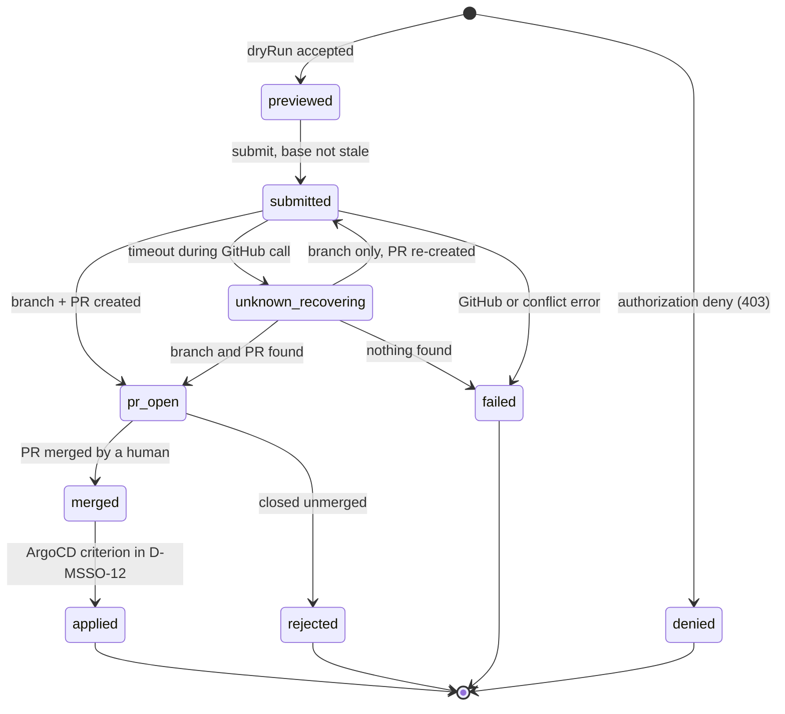

# ADR-0009: SSO Change Requests via Git PR — Controlled Editing of the Declarative SSO Configuration

- **Status**: Proposed — design proposal; no write endpoint, GitHub integration, authorization code, audit store or gateway consumer of `allowedGroups` is implemented by this ADR.
- **Date**: 2026-10-17
- **Issue**: none recorded (*not verified*).
- **Related**: [ADR-0002](0002-backend-api-technology.md) (Domain API, Hono; D-MSSO-7 is an explicit exception to its OPA decision), [ADR-0006](0006-safe-actions.md) (Safe Actions, section 0 hard prerequisite), [ADR-0008](0008-gitops-argocd-integration.md) (read-only ArgoCD account), beluga root `docs/adr/0006-gateway-sso-oidc-architecture.md` (Gateway SSO/OIDC, repo root) (D-SSO-1..4; a different series from the manager ADR-0006), `AGENTS.md` (domain registry, independent review gate).
- **Deciders**: dasomel

Conventions: **Current state** lists observed facts (file/symbol or a command, evidence date 2026-10-17, beluga `main` at `76500d5`). Everything else is design intent. Numbers are *Proposed*. External facts carry an official URL or are marked *not verified*.

Decision IDs: Stage 2 code (merged in PR #283) already uses D-MSSO-1..5 (`config.ts`, `adapters/sso/ssoAdapter.ts`, `routes/sso.ts`, `schema/sso.ts`, `web/src/views/SsoView.tsx`). This ADR continues at **D-MSSO-6** (D-MSSO-14 is new in this revision). `GET /api/v1/sso` is on `main` since PR #283.

## Context

`gitops/values/sso.yaml` is the single declarative SSO source (beluga D-SSO-1), consumed by both ArgoCD Applications (`valueFiles: ../../values/sso.yaml`), which run with `selfHeal: true`. Editing it by hand is the only way to change SSO today. The owner decided that the Manager may offer edits, **persisted as a Git pull request** (not a direct commit to `main`, not a cluster ConfigMap). A human merges; ArgoCD applies.

**Owner decision (2026-10-17)**: the only SSO setting editable from the Manager is **"groups allowed to access"** — a new per-endpoint field `allowedGroups` (array of Keycloak group names) on gateway-protected endpoints (mode `gateway-oidc`); the first iteration opens **`flink` and `filer` only** (D-MSSO-8). Editing is opened **only after APISIX actually consumes the field** (rollout step ②a). Design review (REVISE) found that the earlier editable field, `protectedPathPrefixes` of `app-oidc` endpoints, is read by no chart template, so editing it would change a file without changing behavior; that contract is removed.

### Current state (observed)

| Fact | Evidence |
|---|---|
| The Domain API has no authentication; `createApp` registers only CORS for `/api/*` with origin `http://localhost:5180`. | `manager/packages/domain-api/src/app.ts` (`createApp`, `cors(...)`). |
| Stage 2 (read-only `GET /api/v1/sso`) is merged (PR #283); there is no write route. The adapter reads a local file. | `manager/packages/domain-api/src/routes/sso.ts`, `adapters/sso/ssoAdapter.ts`; code comment D-MSSO-2 "Mutations (Stage 3) will be handled via GitOps pull requests". |
| No Manager Deployment, Application or route exists under `gitops/`. | `git grep -il "domain-api\|beluga-manager" -- gitops` returns nothing. |
| `sso.yaml` has no `allowedGroups` today. Endpoints: `flink`, `filer`, `catalog-ui` (`gateway-oidc`); `argocd`, `trino`, `superset`, `airflow`, `openmetadata` (`app-oidc`); `catalog-api`, `s3` (`none`). | `gitops/values/sso.yaml`. |
| Only the three `gateway-oidc` routes consume `protectedPathPrefixes`; no `app-oidc` template reads it. | `git grep -n protectedPathPrefixes -- gitops/charts scripts` hits only `gitops/charts/beluga-data/templates/10-apisix-route.yaml` (lines 14-16, 184, 281, 345). |
| Each `gateway-oidc` route uses `openid-connect` with `scope: "openid profile email"`, `set_userinfo_header: false`, and a `proxy-rewrite` that removes `X-Userinfo`, `X-Access-Token`, `X-ID-Token`. No group check exists. APISIX is 3.17.0. | `10-apisix-route.yaml` (lakekeeper-ui, filer, flink blocks); `VERSIONS.md` (APISIX row). |
| The `apisix-gateway` Keycloak client already has the `groups` client scope in `defaultClientScopes`. | `gitops/charts/beluga-platform/templates/keycloak-clients.yaml:273`. |
| Realm groups are `analysts`, `engineers`, `admins` (policy source) and are LDAP-backed in Keycloak. Test users: `beluga-admin` (admins), `beluga-engineer` (engineers), `beluga-analyst` (analysts). | `policies/groups.yaml`; `templates/keycloak-group-mapper.yaml`; `templates/keycloak-users.yaml` (`USERS`). |
| `scripts/ci/check-gateway-sso.py` renders the chart and audits that every `gateway-oidc` endpoint has an `openid-connect` route with sanitized headers; `tests/20-gateway-sso.sh` is the live check (login flow per endpoint). | `scripts/ci/check-gateway-sso.py` (docstring, `audit_gateway_routes`); `tests/20-gateway-sso.sh`. |
| OPA runs in namespace `iam` as Deployment `opa` with `replicas: 1`; policies come from ConfigMap `opa-policies` (`trino.rego`, `kafka.rego`) and a `checksum/policies` annotation rolls the Pod on any change. **No Manager policy package exists.** | `gitops/charts/beluga-platform/templates/opa.yaml` (`replicas` at line 30, `checksum/policies` at line 41). |
| The CNPG operator 1.30.0 is installed cluster-wide by the bootstrap script (manifest applied, rollout of `cnpg-controller-manager` in `cnpg-system` awaited). The existing cluster `postgres-main` (namespace `database`, `instances: 1`, `storage.size: 5Gi`) belongs to `beluga-data`. | `scripts/gitops/01-argocd-bootstrap.sh:482,515`; `VERSIONS.md` (CNPG row); `gitops/charts/beluga-data/templates/02-cnpg.yaml`. |
| Keycloak 26.7.1; realm import runs only on first boot, so clients on an existing cluster are reconciled by the Sync-hook Job `keycloak-clients` (namespace `iam`). | `VERSIONS.md`; `templates/keycloak-clients.yaml` header; beluga D-SSO-3. |
| `beluga-platform` deploys into `platform-system`/`iam`; `beluga-data` is a separate Application; both `selfHeal: true`. | `gitops/apps/beluga-platform.yaml`, `templates/00-namespaces.yaml`. |
| Merge requires an `independent-review` status on the PR head SHA; marking it required is the owner's call. | `AGENTS.md` (independent review gate). |

### External references (opened 2026-10-17)

- GitHub App installation token — <https://docs.github.com/en/apps/creating-github-apps/authenticating-with-a-github-app/generating-an-installation-access-token-for-a-github-app>: "The installation access token will expire after 1 hour."
- GitHub App JWT — <https://docs.github.com/en/apps/creating-github-apps/authenticating-with-a-github-app/generating-a-json-web-token-jwt-for-a-github-app>: expiry "must be no more than 10 minutes into the future".
- OPA REST API (for the D-MSSO-7 follow-up) — <https://www.openpolicyagent.org/docs/rest-api>: an undefined document returns HTTP 200 **without a `result` key**.
- GitHub contents API — <https://docs.github.com/en/rest/repos/contents>: updating a file requires `sha`, "the blob SHA of the file being replaced". The page does **not** state which status a stale `sha` returns (409 and 422 are both listed): *not verified*, so any 409/422 from the write call is treated as a conflict.
- Not opened, *not verified*, to be confirmed at implementation: Keycloak PKCE/client settings, realm JWT algorithm and JWKS path for 26.7.1; the `groups` claim name and whether group values are `admins` or `/admins`; GitHub git-refs/compare endpoints; GitHub rulesets (bypass list and ref targeting for `refs/heads/sso/*`); CNPG declarative roles and generated Secrets (<https://cloudnative-pg.io/documentation/1.30/> pages not opened); whether the CNPG operator watches `platform-system`.
- APISIX 3.17.0 plugin behavior used in D-MSSO-14 (`openid-connect` storing user info in `ctx.external_user` or the `X-Userinfo` header, `claim_schema`, `required_scopes`, `authz-keycloak`, `serverless-post-function` in the access phase) comes from the coordinator's investigation and is *not verified* here; **re-confirm against the 3.17.0 source before implementing**.

## Decision Drivers

1. ADR-0006 section 0 applies unchanged: no mutating route before token validation, per-action authorization, bearer-only credentials, confused-deputy handling, idempotency and audit.
2. Git stays the only way SSO state changes; the Manager never merges, never edits the cluster, never syncs.
3. The server, not the UI, enforces what may be edited; the SSO config is a security perimeter.
4. Fail closed: any doubt about identity, policy or audit means the write is refused.
5. A field is editable only if a running component consumes it and a test proves the effect.

## Considered Options

1. **Manager commits to `main` directly** — rejected: skips review and the independent-review gate.
2. **Manager patches a ConfigMap/Application in the cluster** — rejected: `selfHeal` silently reverts it (`docs/mistakes-log.md`, 2026-08-25 entry) and it bypasses Git.
3. **Personal access token (PAT) for the Git write** — rejected: the credential is attributed to an individual account and is a long-lived token (a fine-grained PAT can be limited to one repository, which is acknowledged); a GitHub App is an installation identity with 1-hour tokens.
4. **Gateway-session auth (APISIX) with forwarded identity headers instead of bearer JWT** — rejected for the write path: the Domain API cannot verify headers; beluga D-SSO-2 sanitizes them precisely because they are spoofable.
5. **Audit tables in the shared `postgres-main` (previous revision)** — rejected: the Manager (`beluga-platform`) would need a Secret and a `pg_hba` login from another Application's namespace, the role SQL would live next to the `policyctl`-generated block in `db-roles.sql`, and ArgoCD gives no ordering across Applications. Replaced by a dedicated cluster (D-MSSO-11).
6. **Authorization as an OPA policy in the first iteration** — deferred: any `opa-policies` change rolls the single OPA replica (`replicas: 1`, `checksum/policies`), which would interrupt Trino and Kafka authorization; needs `replicas >= 2` first (D-MSSO-7 escape hatch).
7. **Opening `protectedPathPrefixes` of `app-oidc` endpoints (previous revision)** — rejected: no template consumes it (Current state).
8. **Group check via APISIX built-ins** — `openid-connect` `claim_schema`: rejected (a failing claim answers 401, not 403, and an array "contains" check is not supported; *not verified*). `required_scopes`: rejected (scopes are not groups and do not fit the session/redirect flow). `authz-keycloak`: rejected (designed for token/UMA resource authorization, a poor fit for the browser session flow). Chosen: D-MSSO-14.
9. **SPA PKCE + bearer JWT, in-process authorization, GitHub App PR, dedicated CNPG audit (chosen)** — D-MSSO-6..14.

## Decision

### D-MSSO-6 Authentication — public PKCE client, bearer JWT (RS256)

- Keycloak realm `beluga` gets a new **public** client `beluga-manager` (Authorization Code + PKCE; redirect URI `https://manager.<baseDomain>/*`), created idempotently by extending the `keycloak-clients` Job as D-SSO-3 did for `apisix-gateway`. PKCE and client setting names are *not verified* against 26.7.1.
- The Domain API validates `Authorization: Bearer` on every `/api/v1/sso/change-requests*` route: signature via the realm JWKS (cached, internal CA trusted), **algorithm pinned to `RS256`** (anything else, including `none` and `HS*`, is rejected; that the realm signs with RS256 is *not verified*), `iss` exactly `https://sso.local.beluga.internal/realms/beluga` (from `sso.yaml`), `aud` containing `beluga-manager`, `exp`/`nbf` with small skew (*Proposed*: 30 s). Cookies are never accepted, so CSRF does not apply (ADR-0006 section 0, item 3).
- Unconfigured authentication means the routes answer 503, never open.

### D-MSSO-7 Authorization — in-process, deny by default (exception to ADR-0002)

- **First iteration**: the Domain API authorizes writes itself. A write (`preview`, `submit`) is allowed only if the **validated** JWT's `groups` claim contains `admins`; everything else is **403**. The group list comes only from the verified token, never from request bodies or headers. Unit tests cover: allowed, no `groups` claim, wrong type, empty, group-name variants (`admins` vs `/admins`, per the real token), and a tampered or expired token. Authorization is re-evaluated at submit, not only at preview.
- **Exception record**: ADR-0002 decision 3 delegates detailed authorization to OPA. This ADR deviates on purpose, for the first iteration only, because adding a Rego package rolls the single OPA replica (Considered Option 6).
- **Escape hatch (follow-up, not scheduled)**: move the check to OPA (`data.beluga.manager.sso.allow_write`, undefined or non-boolean result = deny, unreachable = 503) after OPA runs with `replicas >= 2` and the `opa.yaml` args/checksum roll is safe. The route-level contract (403/503) stays unchanged.

### D-MSSO-8 Edit contract — server-enforced, one field

The server computes the change from a **patch** (endpoint name plus the new `allowedGroups` list), never from a client-supplied document. It edits the YAML preserving comments and order (library chosen at implementation, *not verified*), re-parses the result, and answers **422** unless the **only** difference from the base file is `allowedGroups` of one of `flink`, `filer`.

| Endpoints | Editable | Locked |
|---|---|---|
| `flink`, `filer` (`gateway-oidc`) | `allowedGroups` | everything else: `name`, `host`, `mode`, `clientId`, `protectedPathPrefixes`, `bypassPathPrefixes`, `redirectPath`, `logoutPath` |
| `catalog-ui` (`gateway-oidc`) | nothing in the first iteration | all fields. `catalog-api` on the same host bypasses the gateway (mode `none`; Lakekeeper's own tokens and OpenFGA authorize), so restricting only the UI is weak protection. Open it only if the API path is also covered by a group-aware control (*future condition*). |
| `argocd`, `trino`, `superset`, `airflow`, `openmetadata` (`app-oidc`) | nothing | all fields |
| `catalog-api`, `s3` (`none`) | nothing | all fields |

Invariants (each rejected with 422 and a field-level message):
1. `allowedGroups` is non-empty, strings only, no duplicates.
2. Every entry exists in `policies/groups.yaml` (read from `main` with the same blob-SHA discipline as `sso.yaml`).
3. `admins` is always present (anti lock-out: the admins who edit must keep access).
4. No other field of any endpoint, and no other file, changes. The target path is the server constant `gitops/values/sso.yaml`; clients cannot choose it.
5. **Preview is a semantic comparison only**: it compares the `allowedGroups` set before and after; if the set is unchanged the preview answers **422** ("no effective change"). The Manager does **not** run helm; rendering and contract checks happen only in beluga CI (`check-gateway-sso.py`, D-MSSO-9).

The write routes answer 503 `CONSUMER_NOT_DEPLOYED` until an explicit configuration switch (default off) is turned on. The switch is turned on only after the live test of rollout step ②a has passed, not because a marker exists in chart values.

### D-MSSO-9 Concurrency, stale detection, idempotency

- **Stale rule (single definition)**: the preview returns `baseBlobSha`, the blob SHA of `gitops/values/sso.yaml` on `main` at preview time. At submit the server resolves current `main` HEAD, reads the blob SHA of that file at that commit, and answers **409 `STALE_BASE`** if it differs. Unrelated commits do not make a preview stale; HEAD equality is not checked.
- The branch is created from the **same commit SHA** whose blob was checked, and the file write passes that blob SHA as `sha`; any 409/422 from the write is a conflict (stage `failed`, 409 to the caller).
- **Current-state table `sso_change_requests`** (UPDATE allowed; separate from the append-only audit table of D-MSSO-11): one row per request with `id`, `stage`, `file_path`, `endpoint`, `idempotency_key`, `payload_sha256`, `branch`, `pr_number`, `updated_at`. A **partial unique index** on `(file_path) WHERE stage IN ('submitted','pr_open','unknown_recovering')` enforces **one active request per file**; the submit transaction also takes `pg_advisory_xact_lock` on a constant key before the check-and-insert. Concurrent submits therefore yield one PR; the loser gets **409 `OPEN_REQUEST_EXISTS`**.
- **Idempotency**: header `Idempotency-Key` = 32 lowercase hex characters (unique in `sso_change_requests`). The branch name is deterministic: `sso/<endpoint>-<first 12 characters of the key>`, e.g. key `3f9a1c7e5b2d4a8f9c0e1d2b3a4f5e6d` on `flink` gives `sso/flink-3f9a1c7e5b2d`. A replay with the same key and payload returns the existing record; same key with a different payload hash is **422 `IDEMPOTENCY_MISMATCH`**.
- **Re-validation at merge time (M2)**: the Manager's check is advisory because `main` can move between submit and merge. beluga CI therefore also enforces the contract on every PR that touches `sso.yaml`: `check-gateway-sso.py` is extended with the `allowedGroups` invariants (D-MSSO-8, items 1-3) and the helm render check. The owner turns on branch protection "require branches to be up to date before merging" (Open Owner Question 3), so a merge always follows a CI run against the current `main`.

### D-MSSO-10 Git write path — GitHub App

- A GitHub App installed on `dasomel/beluga` only, permissions Contents (write), Pull requests (write), Metadata (read). The Manager mints a JWT (max 10 minutes) and exchanges it for an installation token (1 hour) per use, cached in memory only (URLs above). The code path only creates `sso/*` branches and PRs, and has **no merge call**.
- **Key handling**: the owner creates the Secret (App ID, installation ID, private key) in `platform-system`; a `Role` allows `get` on that Secret only for the Manager ServiceAccount; the key is mounted as a file and never reaches the browser, logs or audit rows. The Secret is **added to the DR and Kakao redeploy checklists** (Secrets are not in Git; `csp/kakao-cloud` is the existing redeploy path).
- **Blast-radius limit**: a GitHub ruleset restricts the App's bypass and writes to `refs/heads/sso/*` so its credentials cannot push to `main` (ruleset capability *not verified*, see references); the server independently fixes the path to the constant `gitops/values/sso.yaml` and refuses any other.
- The PR body and the commit trailer record `Requested-by: <username> (<sub>)`, the reason (length-capped, rendered as escaped text), the diff and `baseBlobSha`; the App is the git author, the human is recorded. This is the **secondary** audit record.

### D-MSSO-11 Audit — dedicated CNPG cluster, append-only by grants, fail-closed

- **Store**: a small, Manager-only CNPG `Cluster` (*Proposed* name `manager-db`) in `beluga-platform`, namespace `platform-system`, `instances: 1`, a small PVC (*Proposed*: 1Gi). The CNPG operator already runs cluster-wide (Current state), so no new operator is needed; that it watches `platform-system` is *not verified*. The cluster's generated credentials Secret lives in the Manager's own namespace, which removes the cross-Application Secret and `pg_hba` problem and the dependence on `beluga-data`.
- **Tables**: `sso_change_event` (audit, append-only) and `sso_change_requests` (current state, D-MSSO-9). Migrations run as the owner role in a hook Job; the Manager runs as a different **writer role** with `INSERT`+`SELECT` (plus sequence `USAGE`) on `sso_change_event` and no `UPDATE`, `DELETE` or `TRUNCATE` there; it has `INSERT`/`SELECT`/`UPDATE` on `sso_change_requests` only. There is no hash chain. This stops the Manager itself from rewriting history; it does not stop database administrators, and the PR body is the independent second record. How the writer role and its password are declared in CNPG is *not verified*.
- **Rows** (`sso_change_event`): one row per stage transition, never updated: `request_id`, `stage`, `actor_sub`, `actor_username`, `endpoint`, `idempotency_key`, `base_blob_sha`, `payload_sha256`, `pr_number`, `pr_url`, `merge_commit_sha`, `reason`, `detail`, `created_at`.
- **Stage enumeration** = the state machine in D-MSSO-13 plus authorization outcome: `denied`, `previewed`, `submitted`, `pr_open`, `unknown_recovering`, `merged`, `applied`, `rejected`, `failed`.
- **Fail-closed**: the `previewed`/`submitted` row is written **before** any GitHub call. If the insert fails, the request is refused with **503 `AUDIT_UNAVAILABLE`** and nothing is sent to GitHub. Later transitions are retried in the background; their failure never alters Git state.
- **Startup**: the database is in the same Application, but a Pod can still start before it is ready. The Manager starts without the database: `GET` routes work, write routes answer 503 until a connection check passes, and readiness reports the audit store separately.

### D-MSSO-12 Deployment, read source and applied detection

- The Manager is deployed by `beluga-platform` (namespace `platform-system`) behind APISIX at the **new host `manager.<baseDomain>`** (today `manager.local.beluga.internal`). The domain registry in `AGENTS.md` does not list it, so rollout step ②b adds it to the registry and the `/etc/hosts` instructions. The localhost-only CORS in `app.ts` is replaced by an allow-list of that origin.
- **One read source in the cluster (M3)**: `GET /api/v1/sso` and the preview both use the same **GitHub read adapter** (blob of `gitops/values/sso.yaml` on `main` plus the commit SHA). The screen shows the **source commit SHA and refresh time**, so the viewer sees exactly what a preview is based on. The Stage 2 file adapter (D-MSSO-1) stays for **local development** and tests only; the adapter is selected by configuration, and an unconfigured cluster deployment does not fall back to the file adapter silently.
- **applied** = for **both** Applications `beluga-platform` and `beluga-data`, `status.sync.status` is `Synced` and `status.sync.revision` is the PR's `mergeCommitSha` **or a descendant of it** (GitHub compare, *not verified*). ArgoCD is read through the account proposed in ADR-0008 (not implemented yet).
- **Limit**: an Application that is `OutOfSync` for an unrelated reason (or lagging) keeps the request at `merged` ("merged, awaiting apply") even if the change itself is live. The UI says so and links to the Application; the Manager does not try to attribute drift.
- Reverting is a manual revert PR following the normal review gate; a Manager "revert" action is out of scope.

### D-MSSO-13 Request lifecycle and UI



- **Recovery**: from `unknown_recovering` the reconciler re-queries GitHub by the deterministic branch name. Branch and PR found: `pr_open`. **Branch only**: re-create the PR (idempotent by branch). Neither: `failed`. An **orphan PR** (PR exists, no matching record) is never adopted automatically; it is logged and reported to the admin view.
- **Lock release**: a request stuck in `pr_open` (for example a PR abandoned without closing) holds the single-active-request lock. Release is manual: an admin-only endpoint `POST /sso/change-requests/{id}/cancel`, or a documented SQL procedure on `sso_change_requests` by the owner role. Cancel **closes the open PR first**, then releases the lock and writes a `failed` audit row with the reason. If closing fails, the lock stays, the failure is recorded in the audit `detail`, and the call answers 502.
- `draft` exists only in the browser and is not audited. The Manager polls GitHub and ArgoCD (*Proposed*: every 30 s) rather than exposing a webhook. The SSO view shows the declared state of `main`; a pending request is a banner with its PR link and stage. The UI renders the server's edit contract and never decides what is allowed.

### D-MSSO-14 Enforcement of `allowedGroups` in APISIX (new, platform PR ②a)

- `sso.yaml` gains optional `allowedGroups: [<group>, ...]` on `gateway-oidc` endpoints. Absent or empty means **no group restriction** (today's behavior), so existing routes do not change until populated. The Manager never writes an empty list (D-MSSO-8, invariant 1).
- In `gitops/charts/beluga-data/templates/10-apisix-route.yaml`, after `openid-connect` and before the upstream, a `serverless-post-function` (access phase, Lua) reads the groups from the user info that `openid-connect` stored after verifying the session, and answers **403** if none of them is in `allowedGroups`. Source preference: `ctx.external_user` if 3.17.0 exposes it; otherwise the `X-Userinfo` value set by `openid-connect` itself (this needs `set_userinfo_header: true`; the existing `proxy-rewrite` keeps removing it before the upstream). **A client-supplied `X-Userinfo` must never be trusted**: the function must run after `openid-connect` has overwritten the header, and the render check asserts the order. All of this is *not verified* and re-confirmed against the 3.17.0 source first.
- **Revocation delay (known limit)**: `openid-connect` caches the user info in the gateway session, so removing a user from a group takes effect only when the session expires or is re-established. Mitigations: (a) cap the gateway session lifetime (*Proposed*: 1 hour; the APISIX `openid-connect` session setting key is *not verified*); (b) immediate block procedure: remove the user from the group at the source (LDAP), log the user out in the Keycloak admin console or Admin API (user session logout; endpoint *not verified*), then confirm the next request must re-authenticate. Whether a Keycloak logout invalidates the APISIX session cookie is *not verified*; the fallback is rotating `APISIX_OIDC_SESSION_SECRET` (invalidates all sessions; effect *not verified*). **Verification item for ②a**: confirm what the Lua check reads on every request (the session-cached user info vs a fresh lookup) and record it.
- The `groups` claim is present because the `apisix-gateway` client already carries the `groups` scope (Current state). To check against a real token: the claim name; the value format (`admins` vs `/admins`); whether `X-Userinfo` is base64-encoded JSON; and that the Keycloak groups mapper has `userinfo.token.claim` enabled (the user info, not only the access token, must carry `groups`).
- CI contract: `check-gateway-sso.py` asserts that every endpoint with `allowedGroups` renders the check with exactly those groups, after `openid-connect`, and that the Lua text contains no group literal. **Live verification without fighting `selfHeal`**: the ②a PR commits real values to `gitops/values/sso.yaml` and ArgoCD applies them; no ad-hoc override is used (a manual `kubectl apply` would be reverted). Proposed committed defaults: `flink: [admins]` and `filer: [admins, engineers]`. `tests/20-gateway-sso.sh` then asserts `beluga-admin` 200 / `beluga-engineer` 403 on `flink`, and `beluga-engineer` 200 / `beluga-analyst` 403 on `filer`. All three users already exist in `keycloak-users.yaml`. Rationale: a default of all groups cannot prove a 403 live, and an admins-only default for both would leave the `filer` 200 case with only admins; the cost is that engineers lose Flink UI access, an owner decision (Open Owner Question 6).
- Escape hatch: removing `allowedGroups` (or `mode: none`) removes the check. Cost: Lua in the gateway config, one more thing to keep compatible on APISIX upgrades.

## API

New routes, all under `/api/v1` (Stage 2's `GET /api/v1/sso` is the read side):

| Route | Purpose | Notable errors |
|---|---|---|
| `POST /sso/change-requests?dryRun=true` | validate the patch, return diff and `baseBlobSha` (semantic comparison, no helm); writes an audit row | 400, 401, 403, 422, 503 |
| `POST /sso/change-requests` (`Idempotency-Key`) | create branch and PR; returns the record | 401, 403, 409 `STALE_BASE`/`OPEN_REQUEST_EXISTS`, 422, 502, 503 |
| `GET /sso/change-requests/{id}` | current stage of one request | 401, 403, 404 |
| `POST /sso/change-requests/{id}/cancel` | admin: close the open PR and release the lock (D-MSSO-13) | 401, 403, 404, 409, 502 |

Status codes: 401 invalid token; 403 not in `admins`; 503 audit unavailable, authentication unconfigured or consumer not deployed; 502 GitHub failure after the audit row exists.

```json
{
  "id": "0b6f6f0e-2a3c-4a53-9f1d-0d0c2f4e9a11",
  "stage": "pr_open",
  "endpoint": "flink",
  "patch": { "allowedGroups": ["admins", "engineers"] },
  "baseBlobSha": "aaaaaaaaaaaaaaaaaaaaaaaaaaaaaaaaaaaaaaaa",
  "sourceCommitSha": "bbbbbbbbbbbbbbbbbbbbbbbbbbbbbbbbbbbbbbbb",
  "branch": "sso/flink-3f9a1c7e5b2d",
  "pr": { "number": 0, "url": "https://github.com/dasomel/beluga/pull/0" },
  "mergeCommitSha": null,
  "diff": "--- a/gitops/values/sso.yaml\n+++ b/gitops/values/sso.yaml\n..."
}
```

(Placeholder values, not real SHAs or PR numbers.)

## Consequences

### Positive
- The only editable setting has a real, tested effect at the gateway, and access narrowing goes through review, the independent-review gate and ArgoCD.
- No cluster write credentials in the Manager; authorization and audit have no cross-Application dependency.
- The edit contract lives in one place on the server and is re-checked in CI at merge time.

### Negative
- New platform work: gateway consumer (Lua), Keycloak client, dedicated CNPG cluster, Manager deployment, a new host, a GitHub App and its Secret/Role/ruleset.
- Authorization is in-process, diverging from ADR-0002 until the OPA follow-up.
- Writes are unavailable whenever the audit database or GitHub is down (intended).
- The contract is deliberately narrow; opening more fields is a separate decision under Driver 5.

## Risks and Mitigations

| Risk | Mitigation |
|---|---|
| Lua check misreads groups and locks everyone out | `admins` forced into every list; absent list = no restriction; live 200/403 test (tests/20); manual revert PR as recovery. |
| Group removal not effective until the gateway session expires | Session lifetime cap (*Proposed*: 1 h) and the immediate block procedure in D-MSSO-14. |
| Forged `X-Userinfo` from a client | Never trusted: function runs after `openid-connect` overwrites it; CI asserts order (D-MSSO-14). |
| App private key theft | Narrow repo and permissions, ruleset limiting writes to `sso/*`, constant file path, key rotation by regenerating the key (procedure *not verified*). |
| Merge of a stale PR | CI re-validation plus "up to date" branch protection (D-MSSO-9). |
| Audit database outage blocks all edits | Accepted (fail-closed); GitOps edits by hand remain possible. |
| Stuck active request blocks new ones | Admin cancel / SQL procedure (D-MSSO-13). |
| `reason` text injects Markdown/links into the PR | Length cap, escaped rendering, never interpreted as instructions. |

## Open Owner Questions

1. **Create the GitHub App and its Secret** (App ID, installation ID, private key in `platform-system`), and apply a ruleset that limits App writes to `refs/heads/sso/*`.
   - *Recommendation*: yes, before rollout step ④.
2. **Add the Secret to the DR and Kakao redeploy checklists.**
   - *Recommendation*: yes; it is not in Git.
3. **Branch protection on `main`: require `independent-review` and "up to date before merging"?**
   - *Recommendation*: yes to both before the write path is enabled.
4. **Order against ADR-0008**: `applied` detection needs the read-only ArgoCD account.
   - *Recommendation*: land that account first, or ship without `applied` (stop at `merged`).
5. **Exact `groups` claim name, `admins` value format, `X-Userinfo` encoding and the Keycloak groups mapper `userinfo.token.claim` setting in the live realm.**
   - *Recommendation*: read from a real token and user info before writing the authorization code and the Lua check.
6. **Committed defaults for ②a** (`flink: [admins]`, `filer: [admins, engineers]`) and a 1-hour gateway session cap.
   - *Recommendation*: yes; it makes the live 200/403 proof possible. Engineers lose Flink UI access, so confirm.

(Answered by the owner on 2026-10-17 and therefore removed: which fields are editable — `allowedGroups` only; Manager namespace — `platform-system`; audit store placement — dedicated cluster; authorization engine for the first iteration — in-process.)

## Owner manual tasks (summary; detailed runbook is a follow-up)

1. Create a GitHub App with Contents/Pull requests write and Metadata read; install it on `dasomel/beluga` only.
2. Create the App Secret in `platform-system`; add it to the DR and Kakao redeploy checklists.
3. Configure the ruleset (App writes only to `sso/*`) and branch protection (`independent-review`, up to date).
4. Approve the new host `manager.local.beluga.internal`.

## Rollout and follow-up tasks

- **① Decision document**: this ADR (and its Korean twin) reviewed and merged. *Acceptance*: independent review PASS on the head SHA.
- **②a Platform consumer (GitOps PR)**: `allowedGroups` in `sso.yaml` schema, Lua check in `10-apisix-route.yaml`, committed defaults, session cap, `check-gateway-sso.py` contract and self-tests, `tests/20-gateway-sso.sh` 200/403 cases. *Acceptance*: `check-gateway-sso.py` passes with negative self-tests (missing check, wrong order, group mismatch); live, after ArgoCD applied the committed values: `beluga-admin` 200 / `beluga-engineer` 403 on `flink`, `beluga-engineer` 200 / `beluga-analyst` 403 on `filer`, at the registry host (not only the Service); this live pass is the condition for turning the Manager's edit switch on.
- **②b Manager deployment, identity, read**: Deployment/Application in `platform-system`, APISIX route for `manager.<baseDomain>` (added to the `AGENTS.md` registry and `/etc/hosts` instructions), Keycloak client `beluga-manager` via `keycloak-clients`, JWT validation (RS256 pinned), in-process `admins` authorization with unit tests, GitHub read adapter with source SHA/time on screen. *Acceptance*: login at the new host through the gateway; unauthenticated 401, non-`admins` 403; `GET /sso` shows the `main` SHA.
- **③ Audit DB, idempotency, preview**: dedicated CNPG cluster, migrations, writer role, `sso_change_requests` with `file_path`, the partial unique index and advisory lock, idempotency, stale detection, semantic preview, CI contract and helm render check on PRs. *Acceptance*: killing the database makes writes 503 with no GitHub call; concurrent submits yield one active request; an unchanged group set gives 422; invariant violations give 422.
- **④ GitHub App write and UI**: App adapter (key from Secret, Role), submit, recovery, cancel, form, diff preview, banner, polling of PR and ArgoCD. *Acceptance*: PR created from `sso/*` only; replay returns the same record; stage reaches `applied` only when both Applications are `Synced` at or after `mergeCommitSha`; an unrelated `OutOfSync` leaves `merged`.
